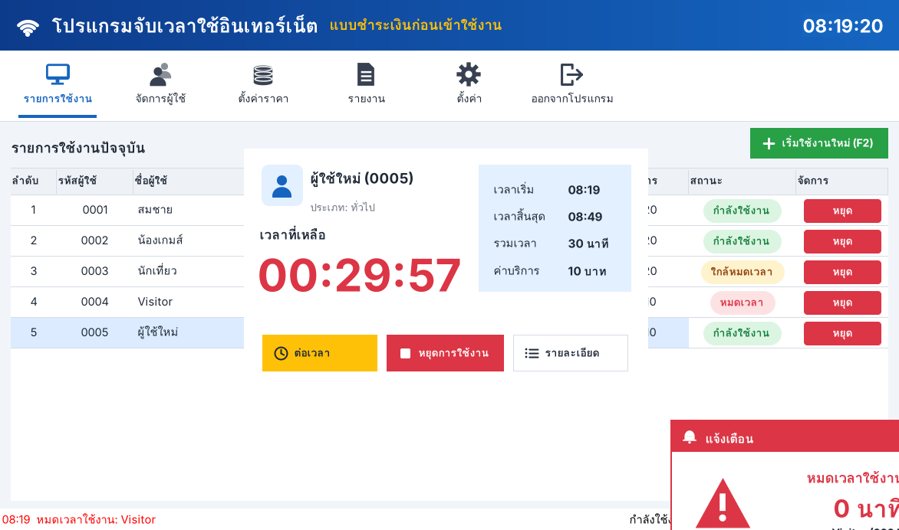

# NetTimer — โปรแกรมจับเวลาใช้อินเทอร์เน็ต แบบชำระเงินก่อนเข้าใช้งาน



โปรแกรมเล็ก ๆ (ไฟล์เดียว ~90 KB) สำหรับร้านอินเทอร์เน็ต/ร้านเกม ใช้บนเครื่องแคชเชียร์ที่เป็น Windows
ไม่ต้องติดตั้ง ไม่ต้องใช้ฐานข้อมูล ไม่ต้องต่อเน็ต

## วิธีเปิดใช้งาน

1. คัดลอกโฟลเดอร์ `netcafe-timer` (หรืออย่างน้อยไฟล์ `NetTimer.exe`) ไปไว้ในเครื่อง เช่น `D:\NetTimer\`
2. ดับเบิลคลิก `NetTimer.exe`
3. ข้อมูลทั้งหมดเก็บอยู่ในโฟลเดอร์ `data\` ข้าง ๆ ไฟล์โปรแกรม
   (ถ้าโฟลเดอร์นั้นเขียนไม่ได้ จะเก็บไว้ที่ `%AppData%\NetTimer` แทน)

ใช้ได้กับ Windows 7 / 8 / 10 / 11 (ต้องมี .NET Framework 4 ซึ่งติดมากับ Windows 8 ขึ้นไปอยู่แล้ว
ส่วน Windows 7 ถ้ายังไม่มีให้ติดตั้ง .NET Framework 4.x จาก Microsoft)

### คอมไพล์เองจากซอร์สโค้ด

ดับเบิลคลิก `build.bat` — ใช้ตัวคอมไพเลอร์ C# (`csc.exe`) ที่ติดมากับ Windows อยู่แล้ว
ไม่ต้องติดตั้ง Visual Studio จะได้ไฟล์ `NetTimer.exe` ใหม่ในโฟลเดอร์เดียวกัน

## ใช้งานง่าย 3 ขั้นตอน

1. **เลือกผู้ใช้งาน** — กด **เริ่มใช้งานใหม่ (F2)** → พิมพ์ค้นหาชื่อ/รหัส/เบอร์โทร → **เลือก**
   (ลูกค้าใหม่กด **เพิ่มผู้ใช้ใหม่** ได้ในหน้าเดียวกัน ลูกค้าขาจรใช้ผู้ใช้ "Visitor")
2. **เลือกเวลาและชำระเงิน** — คลิกแพ็กเกจ (30 นาที / 1 ชั่วโมง / 2 ชั่วโมง ... หรือกดเลข 1-9)
   หรือ **กำหนดเอง** เป็นชั่วโมง → โปรแกรมรวมเงินให้ → กด **ชำระเงินและเริ่มใช้งาน** (Enter)
3. **เริ่มใช้งาน** — หน้าจอนับถอยหลัง แสดงเวลาที่เหลือตัวใหญ่ พร้อมปุ่ม **ต่อเวลา** / **หยุดการใช้งาน** / **รายละเอียด**

เมื่อลูกค้าเลิกใช้: กดปุ่ม **หยุด** สีแดงท้ายแถวในตาราง → **หยุดการใช้งาน**

## หน้าจอหลัก

| ส่วน | ทำอะไร |
|---|---|
| รายการใช้งาน | ตารางรายการปัจจุบัน: ลำดับ, รหัสผู้ใช้, ชื่อผู้ใช้, เวลาเริ่ม, เวลาสิ้นสุด, เวลาที่เหลือ, ค่าบริการ, สถานะ, ปุ่มจัดการ |
| จัดการผู้ใช้ (F8) | เพิ่ม / แก้ไข / ลบ / ค้นหา ผู้ใช้หรือสมาชิก — รหัส, ชื่อ, ประเภท (สมาชิก/ทั่วไป), เบอร์โทร, หมายเหตุ |
| ตั้งค่าราคา | เพิ่ม / แก้ไข / ลบ แพ็กเกจเวลา (ระยะเวลา → ราคา) และราคาต่อชั่วโมงสำหรับ "กำหนดเอง" และคิดค่าใช้เกินเวลา |
| รายงาน (F7) | ดูรายการที่บันทึกไว้ เลือกช่วงวันที่ ค้นหาชื่อ/รหัส รวมยอดทั้งสิ้น ส่งออกเป็นไฟล์ Excel (CSV) |
| ตั้งค่า | ชื่อร้าน, เตือนก่อนหมดเวลากี่นาที, นาทีผ่อนผัน, เสียงเตือน, เปิดโปรแกรมอัตโนมัติพร้อม Windows |

**สถานะในตาราง:** กำลังใช้งาน (เขียว) · ใกล้หมดเวลา (เหลือง) · หมดเวลา (แดง) · หยุดชั่วคราว (เทา) · รอชำระเงิน (แดง)

**แก้ไขรายการจับเวลา (F4):** เปลี่ยนผู้ใช้, เวลาเริ่ม, เวลาสิ้นสุด, ค่าบริการ, สถานะ, หมายเหตุ
คลิกขวาที่รายการเพื่อดูคำสั่งทั้งหมด (เปิดดู, ต่อเวลา, แก้ไข, หยุดชั่วคราว, หยุดการใช้งาน, ยกเลิกรายการ)

**แจ้งเตือน:** เมื่อเหลือเวลาตามที่ตั้งไว้ (ค่าเริ่มต้น 5 นาที) และเมื่อหมดเวลา จะมีหน้าต่างเตือนสีแดงที่มุมขวาล่าง
พร้อมเสียง โดยไม่แย่งโฟกัสจากงานที่ทำอยู่ — หน้าต่างหมดเวลามีปุ่ม **ต่อเวลา** ให้กดได้ทันที

## ระบบป้องกันเครื่อง Hang / ไฟดับ

- บันทึกข้อมูลลงดิสก์ **ทุกครั้งที่มีการเปลี่ยนแปลง** และ **ทุก 10 วินาที** ระหว่างจับเวลา
- พอเลือกผู้ใช้ รายการจะถูกบันทึกเป็น **"รอชำระเงิน"** ทันที — ถ้าไฟดับก่อนกดชำระเงิน
  เปิดเครื่องใหม่จะมีหน้าต่าง **รายการค้างชำระ** ขึ้นมา กด **ชำระเงินและเริ่มใช้งาน** ได้เลย (หรือเปลี่ยนเวลา/ยกเลิก)
- รายการที่กำลังใช้งานอยู่ก็กลับมาครบ ถ้าโปรแกรมหยุดไปเกิน 1 นาทีจะถามว่า:
  - **ใช่** — ลูกค้ายังใช้เครื่องอยู่ (เช่น เครื่องแคชเชียร์ค้างเครื่องเดียว) → นับเวลาช่วงนั้นด้วย
  - **ไม่** — ไฟดับทั้งร้าน ลูกค้าใช้ไม่ได้ → ไม่นับช่วงนั้น
- เขียนไฟล์แบบปลอดภัย: เขียนไฟล์ชั่วคราวให้ลงดิสก์จริงก่อน (write-through) แล้วค่อยสลับแทนไฟล์เดิม
  พร้อมเก็บไฟล์สำรอง `state.xml.bak` — ถ้าไฟล์หลักเสีย โปรแกรมจะกู้จากไฟล์สำรองให้เอง
- แนะนำให้ติ๊ก *ตั้งค่า → เปิดโปรแกรมอัตโนมัติเมื่อเปิด Windows* เพื่อให้ไฟมาแล้วโปรแกรมเปิดเองทันที

## ปุ่มลัด

| ปุ่ม | ทำอะไร |
|---|---|
| F2 | เริ่มใช้งานใหม่ |
| Enter / ดับเบิลคลิก | เปิดดูรายการ (หน้านับถอยหลัง) |
| F3 | ต่อเวลา |
| F4 | แก้ไขรายการ |
| F6 | หยุดชั่วคราว / เล่นต่อ |
| F9 | หยุดการใช้งาน |
| Del | ยกเลิกรายการ |
| F7 | รายงาน |
| F8 | จัดการผู้ใช้ |
| F1 | วิธีใช้งาน |

## การคิดเงิน

- จ่ายตามแพ็กเกจที่ตั้งไว้ (ค่าเริ่มต้น 30 นาที 10 บาท, 1 ชม. 20, 2 ชม. 40, 3 ชม. 60, 5 ชม. 100)
- "กำหนดเอง" = จำนวนชั่วโมง × ราคาต่อชั่วโมง ปัดขึ้นเป็นบาท
- ใช้เกินเวลาเกินกว่านาทีผ่อนผัน (ค่าเริ่มต้น 2 นาที) จะคิดตามนาทีที่เกิน — ตอนหยุดการใช้งานแก้ยอดนี้ได้
  และมีช่องรับเงินคำนวณเงินทอนให้

## ไฟล์ข้อมูล (`data\`)

| ไฟล์ | เนื้อหา |
|---|---|
| `state.xml` | ตั้งค่า, แพ็กเกจราคา, ผู้ใช้, รายการที่กำลังใช้งาน/รอชำระเงิน |
| `state.xml.bak` | ไฟล์สำรองของ state.xml ก่อนบันทึกครั้งล่าสุด |
| `history-YYYY-MM.txt` | ประวัติรายการที่หยุดใช้งาน/ยกเลิก แยกไฟล์รายเดือน (ข้อความคั่นด้วย Tab) |
| `error.log` | บันทึกข้อผิดพลาด (ถ้ามี) |

สำรองข้อมูลได้ง่าย ๆ โดยคัดลอกโฟลเดอร์ `data` ทั้งโฟลเดอร์

## โครงสร้างซอร์สโค้ด

```
netcafe-timer/
  NetTimer.exe     โปรแกรมที่คอมไพล์แล้ว พร้อมใช้
  build.bat        คอมไพล์ใหม่ด้วย csc.exe ของ Windows
  src/Core.cs      ข้อมูล, การคิดเงิน, การนับเวลา, การบันทึกไฟล์แบบกันไฟดับ
  src/Ui.cs        ธีมสี ฟอนต์ ไอคอน (วาดเอง) และตัวช่วยสร้างหน้าจอ
  src/Main.cs      หน้าจอหลัก
  src/Dialogs.cs   หน้าต่างย่อย: เลือกผู้ใช้, เลือกเวลา, นับถอยหลัง, แก้ไข, ราคา, รายงาน, กู้คืน, แจ้งเตือน
```
